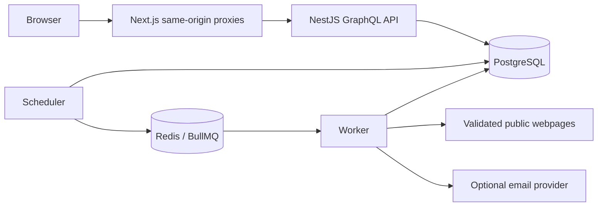

# PageRadar developer handbook

A webpage-change monitor built from a Next.js frontend, NestJS GraphQL API, Prisma/PostgreSQL persistence, and BullMQ/Redis jobs. Watches produce snapshots, changes, check history, and in-app/email notifications.

## Start locally

Follow the root README's service prerequisites, then:

```sh
npm ci
cp .env.example .env
npm --workspace @pageradar/api run prisma:generate
npm run dev:local
```

Use Node.js 22 or newer. Configure a `JWT_SECRET` of at least 32 characters and local PostgreSQL URLs in `.env` first. `dev:local` reads `.env`, rejects remote database hosts, retains service data under `.local/`, applies migrations, and starts API/web development processes. PostgreSQL comes through a development dependency; Redis is downloaded and compiled on first use, requiring network access and a C build toolchain. Web uses port 3000 and API 3001. For existing external services use the README's separate web/API commands with matching environment configuration.

## Architecture



Auth uses a server-managed HttpOnly cookie at the browser boundary. `app/graphql/route.ts` and session/email proxies handle same-origin forwarding. Nest feature modules cover users/auth, watches/interests, monitoring, changes/snapshots, and notifications. `apps/api/prisma/schema.prisma` defines storage; generated GraphQL schema is `apps/api/src/schema.gql`.

Monitoring creates durable check records, schedules through an outbox/queue, validates target URLs, normalizes page content, compares snapshots, classifies changes, and delivers eligible alerts. Baselines and failed checks are different states. Protected or JavaScript-dependent pages can fail without replacing a good baseline.

## Configuration

`DATABASE_URL` is for runtime database access; `DIRECT_URL` is for migrations. `REDIS_URL` supports durable monitoring. Browser GraphQL uses `/graphql`; `INTERNAL_API_URL` identifies the server-side upstream. Set matching `APP_ORIGIN` and `FRONTEND_URL` for deployed cookies and links.

Production separates `RUNTIME_ROLE=api`, `scheduler`, and `worker`. Memory queue mode is explicitly a development-only option. LLM classification is opt-in through `LLM_ENABLED`; deterministic classification works without a key. Email requires configured provider/from/webhook settings and the verification/consent flow documented in `docs/email-notifications.md`. Never place provider or signing secrets in public frontend variables.

## Checks and operations

Run `npm run typecheck`, `npm run lint`, `npm test`, `npm run graphql:generate`, and `npm run build` for source checks. Browser tests use Playwright; integration/runtime/full/load scripts require their isolated PostgreSQL/Redis services and ports. The complete command list is in the source reference and root README. Fixture load results are not a capacity guarantee for arbitrary public sites.

Use committed Prisma migrations for upgrades and preserve PostgreSQL backups. The README documents separate-database restore verification and queue recovery; avoid starting restored workers against real email or monitoring targets until the restore is isolated. Dockerfiles and Compose describe deployment topologies; a frontend process alone does not perform scheduled checks.

When changing an API field, update the resolver/model, regenerate GraphQL artifacts, and check matching frontend queries. When changing extraction/classification, check baseline compatibility and evidence accuracy. See `BACKEND_CONTRACT.md`, `UX-CONTRACT.md`, and the email guide for detailed invariants.

## More documentation

- [Source, command, and configuration reference](REFERENCE.md)
- [Contributing](../CONTRIBUTING.md)
